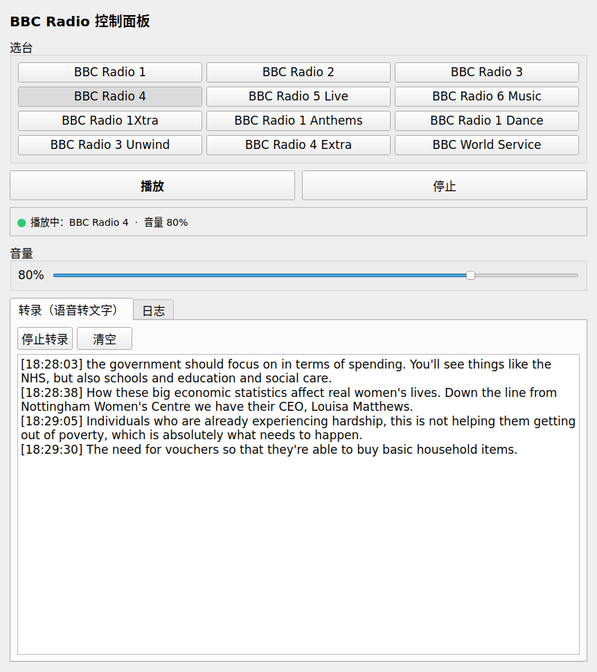

# BBC Radio

Linux 上的 BBC 电台播放器，带**实时语音转文字**。

[](https://github.com/mrusa01/bbc-radio/releases/latest)
[](LICENSE)

- 12 个电台：Radio 1–6、1Xtra、1 Anthems、1 Dance、3 Unwind、4 Extra、World Service
- 命令行 + PyQt5 图形界面双入口
- 实时转录用 [faster-whisper](https://github.com/SYSTRAN/faster-whisper) 在本机 CPU 上跑，**不联网、零 API 费用**
- 附带 [pi](https://github.com/earendil-works/pi) 技能，可以用中文语音指令控制

> 本项目只播放 BBC 公开的直播流，不涉及任何内容下载或再分发。

## 界面预览



选台按钮、播放/停止、音量滑杆，下方标签页实时显示转录文字。

## 下载

不想用 git 的话，直接下载发布包：

**[⬇ bbc-radio-1.0.0.zip](https://github.com/mrusa01/bbc-radio/releases/latest)**

```bash
unzip bbc-radio-1.0.0.zip
cd bbc-radio-1.0.0
./install.sh
```

## 依赖

| 用途 | 需要 |
|---|---|
| 播放 | `mpv`（系统包或 flatpak 版 `io.mpv.Mpv` 均可） |
| 图形界面 | `PyQt5` |
| 实时转录 | `faster-whisper`、`av` |
| 音频抓取 | `curl` |

## 安装

```bash
git clone https://github.com/mrusa01/bbc-radio.git
cd bbc-radio

# 只装命令行
./install.sh --cli-only

# 命令行 + 图形界面 + 桌面图标
./install.sh

# 再加上实时转录依赖（会创建 venv 并下载依赖，较慢）
./install.sh --with-asr
```

安装脚本会把 `bbc-radio`、`bbc-radio-gui` 软链到 `~/.local/bin`，桌面图标写到
`~/.local/share/applications/bbc-radio.desktop`。

确保 `~/.local/bin` 在 `PATH` 中：

```bash
echo 'export PATH="$HOME/.local/bin:$PATH"' >> ~/.bashrc
source ~/.bashrc
```

## 用法

### 命令行

```bash
bbc-radio play 4          # 播放 Radio 4
bbc-radio play            # 不带参数默认 Radio 4
bbc-radio stop            # 停止
bbc-radio list            # 列出所有电台
bbc-radio status          # 播放状态 + 当前音量
bbc-radio volume 60       # 设置音量 0-100
bbc-radio transcribe 4    # 实时转录 Radio 4（Ctrl-C 结束）
```

也可以不安装，直接在仓库里跑：

```bash
python3 bbc_radio_cli.py play 4
python3 bbc_radio_gui.py
```

### 电台代号

| 代号 | 电台 | 代号 | 电台 |
|---|---|---|---|
| `1` | Radio 1 | `1d` | Radio 1 Dance |
| `2` | Radio 2 | `3u` | Radio 3 Unwind |
| `3` | Radio 3 | `4x` | Radio 4 Extra |
| `4` | Radio 4 | `ws` | World Service |
| `5` | Radio 5 Live | `1x` | Radio 1Xtra |
| `6` | Radio 6 Music | `1a` | Radio 1 Anthems |

还支持英文别名，如 `four`、`r4`、`fourfm`、`worldservice`。

### 图形界面

`bbc-radio-gui`，或在应用菜单里搜索 “BBC”。界面提供选台按钮、播放/停止、音量滑杆，
以及「转录」标签页实时滚动显示文字。

## 实时转录说明

转录流程：拉取 HLS 播放列表 → 按序号取最新的音频分片 → 在本地用 faster-whisper 识别 →
每约 32 秒输出一段带时间戳的文本。

- 默认模型 `small.en`，可用 `--model base.en` 换更轻量的
- 只支持英文（BBC 直播流为英文）
- CPU 占用主要取决于模型大小；`base.en` 在老机器上更流畅

首次运行会从 Hugging Face 下载模型（已默认走 `hf-mirror.com` 镜像）。

## 项目结构

```
bbc-radio/
├── bbc_radio/
│   ├── __init__.py
│   ├── stations.py       # 电台清单（唯一数据源）
│   ├── player.py         # mpv 播放 / 停止 / 音量（IPC）
│   └── transcribe.py     # faster-whisper 实时转录
├── bbc_radio_cli.py      # 命令行入口
├── bbc_radio_gui.py      # PyQt5 图形界面
├── install.sh            # 安装脚本
├── requirements.txt
└── pi-skill/             # pi 技能（可选）
```

## 故障排查

**播放没声音**
```bash
# 看 mpv 是否在跑
pgrep -a mpv
# 看 mpv 日志
cat /tmp/bbc_mpv.log
```

**flatpak 版 mpv 无法连接**
本项目用 IPC socket 通信，socket 在 `/tmp`。如果手动启动 flatpak mpv，
需要 `--filesystem=/tmp` 参数；通过本项目启动会自动带上。

**转录启动失败**
```bash
# 检查 faster-whisper 是否装在当前 python
python3 -c "import faster_whisper; print(faster_whisper.__version__)"
```
`av` 必须 `<19`，否则 faster-whisper 1.2.x 会报 API 不兼容。

**命令找不到**
确认 `~/.local/bin` 在 `PATH` 里。

## 许可

MIT，见 [LICENSE](LICENSE)。

BBC 名称与电台内容版权归 British Broadcasting Corporation 所有，本项目与其无关。
